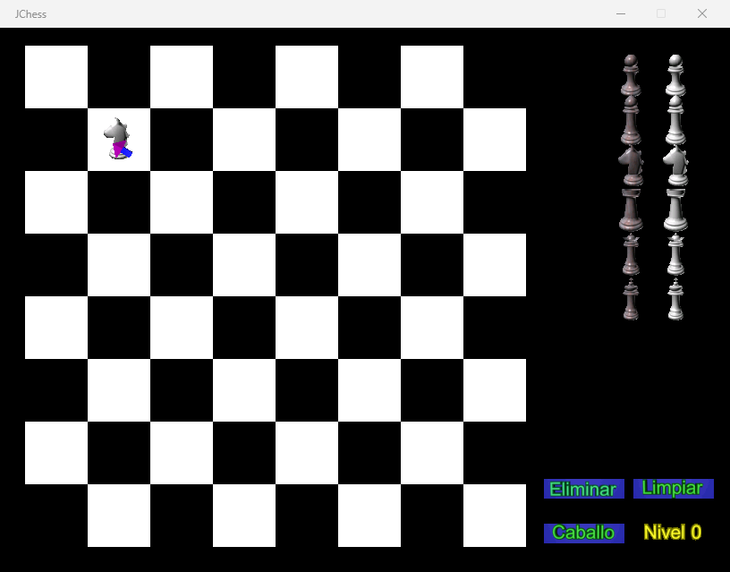
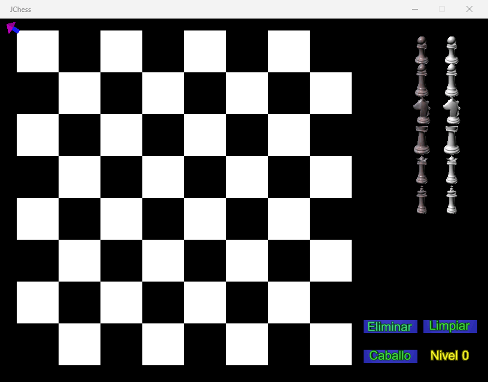
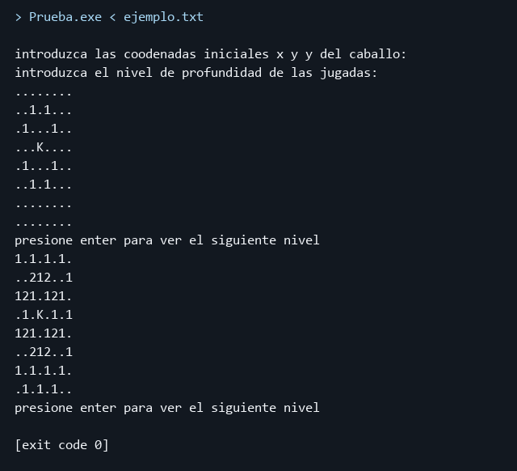
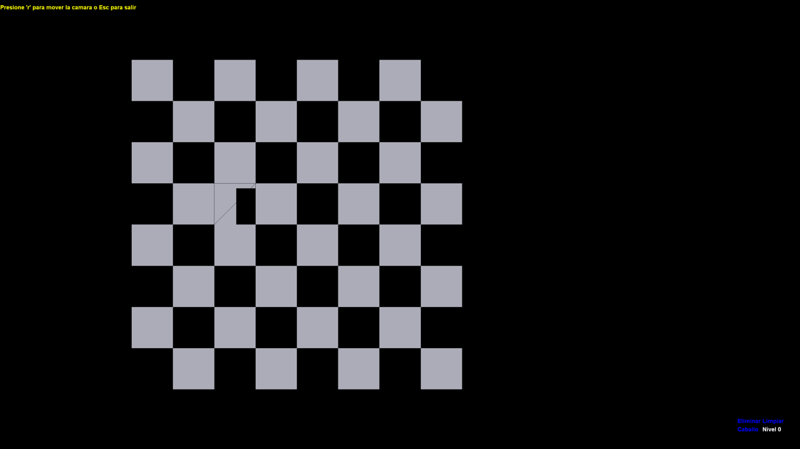

# JChess
[English](#english) · [Español](#español)

## English

Legacy Windows chessboard for exploring the squares a knight can reach

> [!WARNING]
> **Status: Legacy.** The console exercise runs on Windows 11. The historical viewers require additional graphics dependencies.

### Overview

JChess lets a learner place chess pieces on a board and investigate where a knight can move. A knight moves two squares along one axis and one along the other. The desktop project has a flat 2D view and a 3D view; a separate console exercise prints the reachable squares. The tools focus on the board and movement exploration.

### Features

- Opens a selector for a 2D board or a Direct3D 3D view.
- Loads piece sprites and models for the board.
- Displays the knight’s reachable squares at different depths.
- Includes a console exercise with an eight-by-eight text board and a chosen starting square.

### Requirements

- Windows 11 Pro build 26300 was used for this reconstruction. Build Win32 with Visual Studio Community 2026 18.11.4, MSVC 14.51.36263 (v145, toolset directory 14.51.36231), and Windows SDK 10.0.26100.0. The console exercise uses the C++ runtime supplied by the compiler.
- The desktop build uses the original Microsoft DirectX 9.0b SDK and the components listed in [Third-party notices](THIRD-PARTY-NOTICES.md). Its x86 static graphics library predates the SafeSEH linker tables. The converted project enables ASLR and DEP.
- The 2D mode opens in a GDI window by default. The optional fullscreen mode uses DirectDraw with 16-bit colour. [DDrawCompat 0.7.2](https://github.com/narzoul/DDrawCompat/releases/tag/v0.7.2) can be supplied beside `JChess.exe` for a local compatibility test.

### Getting started

The console solution builds independently using the `Prueba.sln` command below. The exact sample files from jchess.rar are already included. Obtain the DirectX 9.0b SDK separately and run both commands in Developer PowerShell for Visual Studio, from the repository root.

```powershell
$sdk = 'C:\ruta\externa\DXSDK-9.0b'
MSBuild src\JChess\JChess.sln /m:2 /nr:false /t:Rebuild /p:Configuration=Release /p:Platform=Win32 "/p:D3DX9Sdk=$sdk"
MSBuild src\Prueba\Prueba.sln /m:2 /nr:false /t:Rebuild /p:Configuration=Release /p:Platform=Win32
Push-Location .\src\JChess
.\bin\Release\JChess.exe
Pop-Location
.\src\Prueba\bin\Release\Prueba.exe
```

### Usage

Open `JChess.exe` from `src/JChess` so the program can locate its pictures and models. Choose the graphics mode before continuing. On the graphical board, use the knight control and the move-depth control to explore reachable squares.

For a short console example, open Prueba.exe, enter 3 3 as the starting square, enter 1 for one move and press Enter to see the grid.

At the first prompt type `3 3`, then type `2` for the search depth. Press Enter after each grid. The first grid has `K` at the starting square and eight `1` marks for one move. The second shows squares reachable within two moves.

### Project structure

`src/JChess/` contains the desktop selector, 2D renderer, piece movement and original graphics. `src/Prueba/` contains the console exercise. Each directory retains the original `.vcproj` and `.legacy.sln` next to its converted solution.

### Support

Report the commit, operating system, selected renderer and toolchain. For the console exercise, include the two coordinates and the number of moves that reproduce the issue.

### Contributing

Build both Win32 solutions and try a position near the centre and near a board edge. Keep historical source credits and third-party requirements with each revision.

### History

The source snapshot comes from `jchess.rar`, whose project files date from 20 March 2005. The date uses 12:00 UTC as a representative time. The 2026 reconstruction converts the two Win32 solutions and includes the exact DirectX sample files and documents the separately supplied SDK. The first documentation update shows how to reproduce the knight exercise from the centre.

### 2D in a window

The 2026 revision opens the 2D board in a normal window using the original drawing code. Choose **2D** and drag a piece from the palette to the board. Set `JCHESS_FULLSCREEN_2D=1` to request the original fullscreen renderer on compatible hardware.

The local test moved a knight onto the board and closed JChess with exit code 0. The earlier commits still require a display setup that supports their fullscreen DirectDraw mode.





### Verification

The historical fullscreen DirectDraw mode requires a desktop and video driver that provide exclusive 16-bit display mode. That environment was unavailable. Each of the first three revisions passed the console example and its 3D camera test. The separate 2026 revision opens the 2D board in GDI, where dragging a knight succeeds. Fullscreen DirectDraw remains selectable and unverified on this machine.

On November 19, 2026, MSBuild 18.11.1.51303 with v145 built both Win32 solutions in four separate cuts. The console reproduced the eight knight moves. The 3D viewer displayed its board and moved the camera with optional effects disabled. The new windowed 2D viewer moved a knight onto the board and closed with exit code 0. The three previous cuts still failed their original fullscreen 2D path in this environment.

Run the console test from the repository root.

```powershell
Get-Content .\examples\ejemplo.txt | .\src\Prueba\bin\Release\Prueba.exe
```






### License

The [MIT license](LICENSE) applies to the project’s own code and documentation. The [third-party notices](THIRD-PARTY-NOTICES.md) describe the external materials.

---

## Español

Tablero de ajedrez legado para Windows con el que se exploran las casillas que puede alcanzar un caballo

> [!WARNING]
> **Estado: Legado.** El ejercicio de consola funciona en Windows 11. Los visores históricos requieren dependencias gráficas adicionales.

### Descripción general

JChess permite colocar piezas de ajedrez en un tablero y explorar a dónde puede saltar un caballo. El caballo avanza dos casillas en un eje y una en el otro. El proyecto de escritorio tiene una vista 2D y otra 3D. Un ejercicio de consola separado imprime las casillas alcanzables.

### Funciones

- Abre un selector para un tablero 2D o una vista 3D con Direct3D.
- Carga imágenes y modelos de las piezas.
- Muestra las casillas que alcanza un caballo a distintas profundidades.
- Incluye un ejercicio de consola con tablero de ocho por ocho y coordenadas de inicio.

### Requisitos

- La reconstrucción usó Windows 11 Pro compilación 26300. Compila para Win32 con Visual Studio Community 2026 18.11.4, MSVC 14.51.36263 (v145, directorio de herramientas 14.51.36231) y SDK de Windows 10.0.26100.0. La consola usa el entorno de ejecución de C++ del compilador.
- La compilación de escritorio usa el SDK original Microsoft DirectX 9.0b y los componentes de [Avisos de terceros](THIRD-PARTY-NOTICES.md). La biblioteca estática x86 es anterior a las tablas SafeSEH del enlazador. El proyecto convertido habilita ASLR y DEP.
- El modo 2D abre en una ventana GDI de forma predeterminada. El modo opcional a pantalla completa usa DirectDraw con color de 16 bits. Puedes colocar [DDrawCompat 0.7.2](https://github.com/narzoul/DDrawCompat/releases/tag/v0.7.2) junto a `JChess.exe` para una prueba local.

### Cómo empezar

La solución `Prueba.sln` se compila por separado con el comando de abajo. Los ejemplos exactos de jchess.rar ya vienen incluidos. Obtén el SDK DirectX 9.0b por separado y ejecuta ambos comandos desde la raíz con Developer PowerShell para Visual Studio.

```powershell
$sdk = 'C:\ruta\externa\DXSDK-9.0b'
MSBuild src\JChess\JChess.sln /m:2 /nr:false /t:Rebuild /p:Configuration=Release /p:Platform=Win32 "/p:D3DX9Sdk=$sdk"
MSBuild src\Prueba\Prueba.sln /m:2 /nr:false /t:Rebuild /p:Configuration=Release /p:Platform=Win32
Push-Location .\src\JChess
.\bin\Release\JChess.exe
Pop-Location
.\src\Prueba\bin\Release\Prueba.exe
```

### Uso

Abre `JChess.exe` desde `src/JChess` para que el programa encuentre las imágenes y los modelos. Elige el modo gráfico antes de continuar. En el tablero gráfico, usa el control del caballo y el de profundidad para explorar las casillas alcanzables.

Para un ejemplo en consola, abre Prueba.exe, escribe 3 3 como posición inicial, escribe 1 para un movimiento y pulsa Enter para ver el tablero.

En la primera pregunta escribe `3 3`. Después escribe `2` para la profundidad de búsqueda. Pulsa Enter después de cada tablero. El primero muestra `K` en la posición inicial y ocho marcas `1` para un movimiento. El segundo muestra las casillas alcanzables en hasta dos movimientos.

### Estructura del proyecto

`src/JChess/` contiene el selector, el visor 2D, los movimientos de las piezas y sus recursos propios. `src/Prueba/` contiene el ejercicio de consola. Cada carpeta conserva el `.vcproj` y `.legacy.sln` originales junto a la solución convertida.

### Soporte

Indica el commit, el sistema operativo, el modo gráfico y las herramientas. Para la consola, agrega las dos coordenadas y el número de movimientos que reproducen el problema.

### Contribuir

Compila las dos soluciones Win32 y prueba una posición cerca del centro y otra junto a un borde. Conserva las atribuciones originales y los requisitos externos de cada edición.

### Historial

La edición proviene de `jchess.rar`, cuyos archivos de proyecto están fechados el 20 de marzo de 2005. Se usa la hora de referencia de 12:00 UTC. La reconstrucción de 2026 convierte las dos soluciones Win32 y incluye los ejemplos DirectX exactos y documenta el SDK que se obtiene por separado. La primera revisión documental explica cómo reproducir el ejercicio del caballo desde el centro.

### 2D en ventana

La revisión de 2026 abre el tablero 2D en una ventana normal y conserva el dibujo original. Elige **2D** y arrastra una ficha desde la paleta hasta el tablero. Define `JCHESS_FULLSCREEN_2D=1` para pedir el modo original a pantalla completa en un equipo compatible.

La prueba local movió un caballo al tablero. JChess se cerró con código 0. Los commits anteriores requieren una configuración gráfica compatible con DirectDraw a pantalla completa.


### Verificación

El modo histórico DirectDraw a pantalla completa requiere un escritorio y un controlador de vídeo compatibles con el modo exclusivo de 16 bits. Ese entorno no estaba disponible. Los tres primeros cortes pasaron el ejemplo de consola y la prueba de cámara 3D. La revisión separada de 2026 abre el tablero 2D con GDI y permite arrastrar un caballo. DirectDraw a pantalla completa sigue disponible como opción y queda sin verificar en este equipo.

El 19 de noviembre de 2026, MSBuild 18.11.1.51303 con v145 compiló las dos soluciones Win32 en cuatro cortes. La consola reprodujo ocho saltos del caballo. El visor 3D mostró el tablero y movió la cámara con los efectos opcionales desactivados. En el nuevo visor 2D en ventana se movió un caballo y el programa cerró con código 0. El modo 2D original a pantalla completa falló en los tres cortes anteriores en este entorno.

Ejecuta la prueba de consola desde la raíz del repositorio.

```powershell
Get-Content .\examples\ejemplo.txt | .\src\Prueba\bin\Release\Prueba.exe
```


### Licencia

La [licencia MIT](LICENSE) aplica al código y la documentación propios. Los [avisos de terceros](THIRD-PARTY-NOTICES.md) describen los materiales externos.
